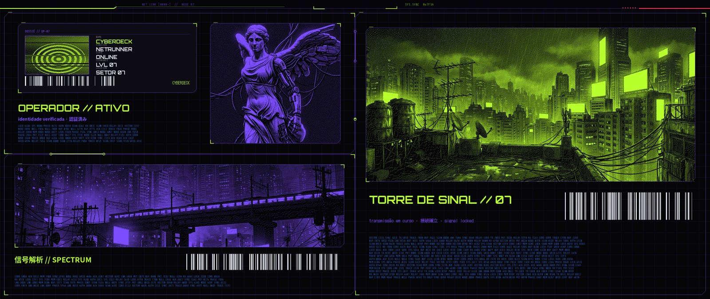
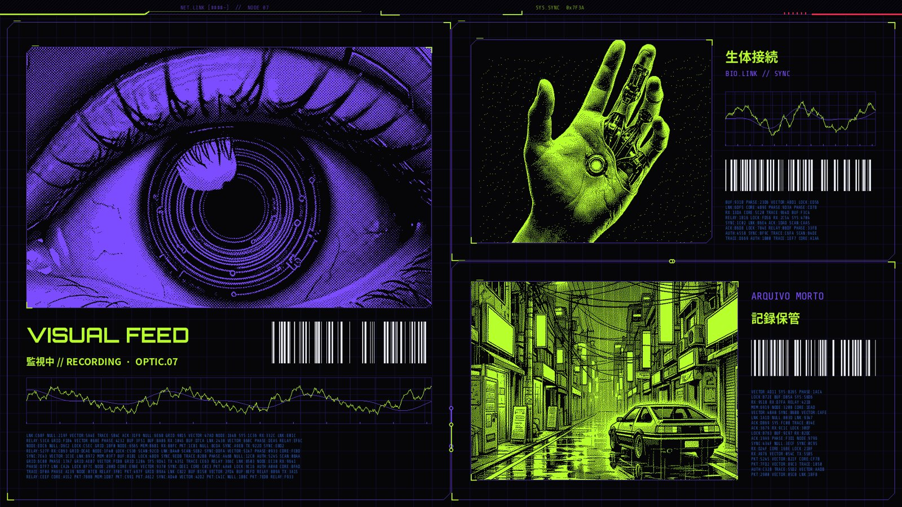
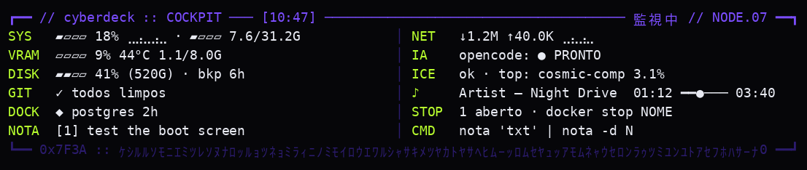
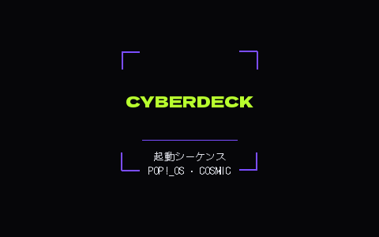
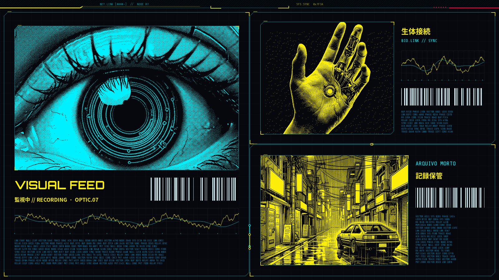

🇺🇸 English · [🇧🇷 Português](README.pt-BR.md)

# cosmic-cyberdeck

**A modular "operator dossier" theme for Pop!_OS 24.04 + COSMIC: one palette file drives the COSMIC theme, terminals, icons, cursor, sounds, boot screen, Brave and a self-assembling tiled layout whose wallpaper is drawn around the windows.**

[](LICENSE)

-3C7BFF.svg)

## 📸 Screenshots

All images below were generated offline by the project's own generators (`gerar_poster.py`, `gerar_boot.py`, `hud.py`), no desktop involved.

<p align="center">
  
</p>
<p align="center">
  
</p>
<p align="center"><sub>Wallpapers for a 2560×1080 + 1920×1080 setup. Each panel sits exactly behind a window slot: with the layout assembled only the frames, labels and circuit traces in the gaps are visible.</sub></p>

<p align="center">
  
</p>
<p align="center">
  
  
</p>
<p align="center"><sub>Terminal HUD, Plymouth boot screen, and the same poster with the alternative <code>nightcity</code> palette.</sub></p>

## ✨ Features

- 🎨 **One source of truth for colors**: `paletas/*.toml` (`acid` = acid green `#B8FF2E` + purple `#7B4DFF`, `nightcity` = yellow/cyan). Every file in `templates/` uses placeholders (`{{accent}}`, `{{hex:foco}}`, `{{rgb:texto}}`).
- ✍️ **Configurable signature**: the text on posters, boot screen, HUD, new tab and fastfetch comes from `config.toml` (default `CYBERDECK`).
- 🪟 **`cyberdeck` layout command** (`montar.py` + `wl/cosmic.py`): a Wayland client that opens/moves apps into a multi-monitor tiled layout defined in `layout.toml`, rotates splits with Super+O and nudges dividers with a virtual keyboard/mouse. It never closes windows. `--plano` only prints the plan; `--gravar` records hand-tuned sizes.
- 🖼️ **Poster wallpaper** (`poster/`): 1-bit dithering, dossier modules, barcodes, waveforms and circuit traces aligned to the layout's gaps. Missing images fall back to abstract textures.
- 📟 **Terminal HUD** (`hud.py`): fixed at the top of a terminal, shell below; quick notes (`nota`), a command catalog (`cmds`), forgotten Docker containers, git radar. Pauses while a program runs.
- 🧩 **Icon theme** (Papirus recolored in duotone, apps on chamfered plates, folders with file-tab codes like `01 // DOC`), 🖱️ **cursor** (Bibata recolored), **COSMIC theme**, **fastfetch logo**.
- 🔊 **System sounds** synthesized from scratch (`gerar_sons.py`).
- 🚀 **Boot screen** (`gerar_boot.py`): Plymouth theme based on `pop-basic`, with an undo.
- 🦁 **Brave** theme (`brave-theme/`) and a local, offline HUD-style new tab (`brave-ntp/`).
- 🔧 **Self-healing on login** (optional): re-applies Spicetify after Spotify updates, recolors icons for new apps, repairs the COSMIC theme after updates, restores the sound theme.
- 💾 **Safe install**: dry run, timestamped backup of every file it changes, one-command uninstall.
- ✅ **~180 tests** (pytest), including a check that computed window rectangles match COSMIC's real geometry pixel by pixel.

## 📋 Requirements

- **Pop!_OS 24.04 with COSMIC 1.11** (Wayland). Other COSMIC distros may work; other desktops won't.
- Python 3.11+ with **Pillow** and **numpy** (`sudo apt install python3-pil python3-numpy`).
- Optional, styled when present: fish, starship, cava, btop, fastfetch, Spotify + Spicetify, VS Code, Brave. `bash instalar-dependencias.sh` installs them (asks before each step).
- Icons: `papirus-icon-theme`. Cursor: [Bibata-Modern-Amber](https://github.com/ful1e5/Bibata_Cursor) in `~/.local/share/icons/` (skipped if missing).
- Fonts: bundled (Orbitron, DotGothic16, Share Tech Mono in `brave-ntp/fontes/`, Dela Gothic One in `fontes/`, all SIL OFL 1.1 with their license files) plus **Noto Sans CJK** (`fonts-noto-cjk`, preinstalled on Pop!_OS). If a font is missing, the poster tests are skipped with a message.
- For the layout command only: [`uv`](https://github.com/astral-sh/uv) and `pywayland` in a local `.venv`, and write access to `/dev/uinput`.

## 🚀 Install

The clone can live anywhere; paths are resolved from the repository folder.

```bash
git clone https://github.com/<you>/cosmic-cyberdeck.git
cd cosmic-cyberdeck
```

**1. Dry run (nothing is changed):**

```bash
python3 install.py --dry-run              # lists every file it would back up/overwrite/create,
                                          # and renders all configs into saida/seco/ to inspect
python3 -m pytest -q                      # optional: needs pytest
```

**2. Apply (backup first, automatically):**

```bash
python3 install.py --paleta acid          # asks for confirmation; --yes to skip
```

Every file and folder it will touch is first copied to `~/.local/share/cosmic-cyberdeck/backups/<YYYYmmdd-HHMMSS>/` together with a `manifest.json` that also records what did *not* exist (so it can be removed later). Then toggle light/dark once (or log out and in) so the compositor reloads gaps and theme.

Optional extras:

```bash
python3 install.py --autostart --shortcut # login maintenance + Super+Y runs the layout (both backed up too)

# Wayland bindings for the `cyberdeck` layout command (stay in .venv, outside git)
uv venv .venv && uv pip install --python .venv/bin/python pywayland
cd wl && ../.venv/bin/python -m pywayland.scanner -i /usr/share/wayland/wayland.xml protocolos/*.xml -o protocol && cd ..
.venv/bin/python montar.py --plano        # shows what it would do, moves nothing

python3 gerar_sons.py                     # writes sounds to saida/sons/ to listen; --instalar to install
python3 gerar_boot.py                     # writes the Plymouth theme + saida/plymouth/INSTALAR-BOOT.sh
sudo bash saida/plymouth/INSTALAR-BOOT.sh # boot screen (sudo; review the script first)
python3 install.py --spotify-hook         # prints the sudo command for the apt hook that keeps Spicetify working
```

Brave: `brave://extensions` → Developer mode → *Load unpacked* → pick `brave-theme/` and/or `brave-ntp/`.

## ↩️ Uninstall

```bash
python3 install.py --uninstall            # restores the most recent backup not yet restored
python3 install.py --list-backups
python3 install.py --restore --backup 20261103-104500   # a specific one (e.g. the very first, pre-theme state)
```

Restoring puts back every backed-up file, deletes files the install created, and removes the generated icon/cursor themes and posters. Each `--uninstall` walks one backup further back. Pieces installed separately have their own undo:

| Piece | Undo |
|---|---|
| Boot screen | `sudo bash saida/plymouth/INSTALAR-BOOT.sh --desfazer` |
| Sound theme | `gsettings reset org.gnome.desktop.sound theme-name && rm -r ~/.local/share/sounds/cyberdeck` |
| apt hook | `sudo rm /etc/apt/apt.conf.d/99cyberdeck-spotify` |
| Spicetify | `spicetify restore` |

## 🎛️ Customization

- **Palette**: copy `paletas/acid.toml` to `paletas/mine.toml`, edit the hex values (keep every key) and run `python3 install.py --paleta mine`. Templates fail loudly (`KeyError`) if a key is missing.
- **Signature**: edit `assinatura` in `config.toml` (uppercase, up to 24 characters), or try it with `CYBERDECK_SIGNATURE=NODE07 python3 gerar_poster.py --todas --destino /tmp/p`. Long names shrink to fit.
- **Layout**: edit `layout.toml` with your monitor names and sizes (`cosmic-randr list`). Each monitor is a tree such as `H(brave,V(hud,arquivos))` (H = side by side, V = stacked). Slots available: `spotify`, `cava`, `terminal_livre`, `hud`, `brave`, `arquivos`.
- **Images**: replace files in `fotos/` (see [docs/image-prompts.md](docs/image-prompts.md)).
- **HUD**: `[hud]` in `config.toml` adds git repositories to watch and a systemd backup unit to report.

## ⚙️ How it works

```
paletas/<name>.toml + config.toml ─► install.py (backup) ─► aplicar.py ─► templates/* ─► ~/.config/... (terminal, fish, btop, cava, Spicetify…)
                                                               ├─► gerar_temas.py / recolorir_tema.py ─► COSMIC theme
                                                               ├─► gerar_icones.py (+ gerar_placas.py), gerar_cursor.py, gerar_logo.py
                                                               └─► gerar_poster.py ─► wallpaper per monitor + brave-ntp/fundo.jpg
layout.toml (+ layout-medido.toml) ─► montar.py (`cyberdeck`) ─► wl/cosmic.py (Wayland) ─► windows in slots
login ─► ao_entrar.sh ─► manutencao.sh ─► montar.py
```

- COSMIC always splits a tile in half along its longer side; when the tree asks for the opposite, the layout command rotates the split with Super+O. Details and pitfalls: [docs/cosmic-notes.md](docs/cosmic-notes.md).
- The poster (`poster/compor.py`) uses the same geometry as the layout, so the art lines up with the gaps.
- `recolorir_tema.py` starts from a pristine copy of the COSMIC dark theme that `install.py` saves on first install (or from `/usr/share/cosmic` if none).
- Live reload: fish (universal variable), cava (`USR2`), the HUD and the COSMIC theme pick up a new palette immediately; Brave, Spotify and btop on reopen.

## 🚧 Limitations

- Targets **COSMIC 1.11**; COSMIC changes fast and theme keys/protocols may move (`verificar_tema.py` repairs known cases).
- The example `layout.toml` is for a 2560×1080 + 1920×1080 pair; other setups need editing.
- The layout command needs `/dev/uinput` access and a `.venv` with pywayland; paths containing spaces are not supported in the Super+Y shortcut.
- `spicetify refresh`, the cosmic-panel restart and fish universal variables are not part of the backup (they are not files the install owns).
- Boot screen and themed login were generated and unit-tested but not yet validated on many machines.
- Code identifiers and comments are in Portuguese; user-facing docs are bilingual.

## 🗺️ Roadmap

1. Generate `layout.toml` from `cosmic-randr list` for any monitor setup.
2. Real desktop screenshots (layout assembled and empty) next to the generated previews.
3. A light palette and a palette preview command.
4. Package fonts/icons install into `install.py --fonts`.
5. English code comments and CLI messages.

## 🤝 Contributing

Issues and PRs are welcome. See [CONTRIBUTING.md](CONTRIBUTING.md) for test setup, style, PR flow and good first issues.

## 📄 License

Code: [MIT](LICENSE), © 2026 (see [LICENSE](LICENSE)). Bundled fonts: SIL Open Font License 1.1 (license files next to each font). Images in `fotos/` were AI-generated for this project and are distributed under the same MIT terms.
