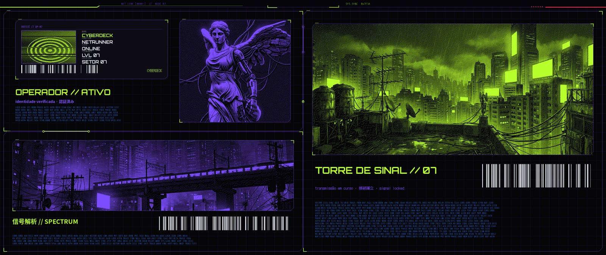
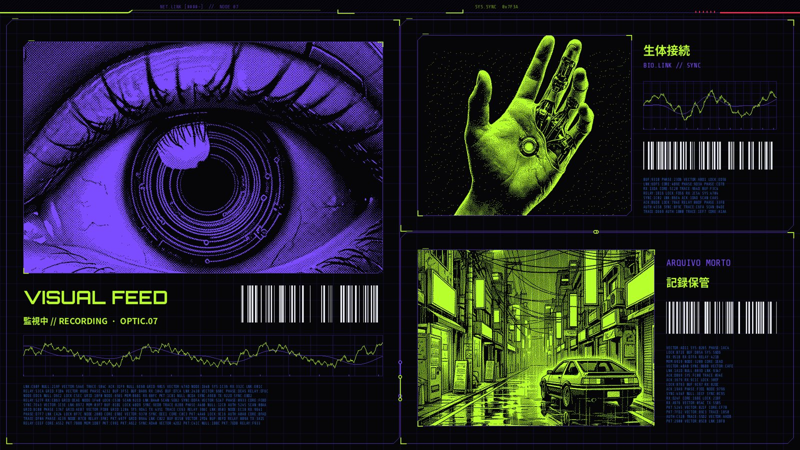
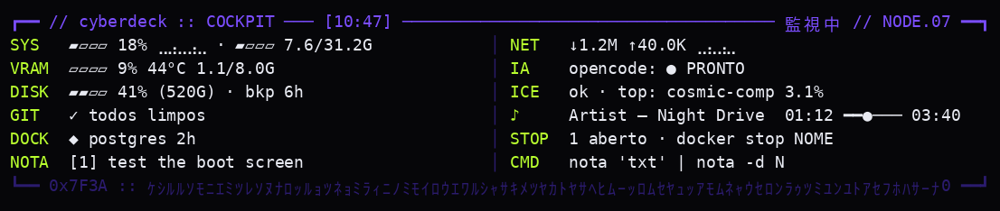
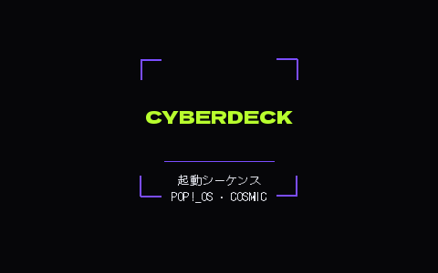
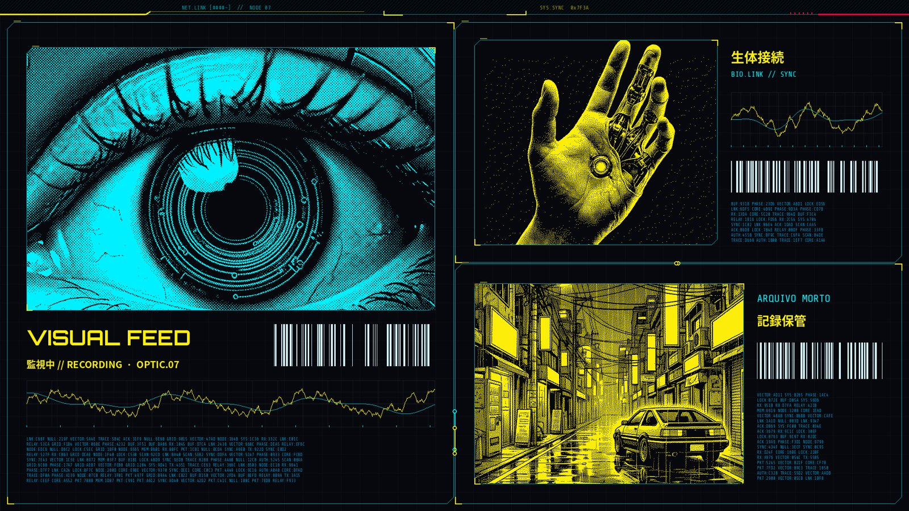

[🇺🇸 English](README.md) · 🇧🇷 Português

# cosmic-cyberdeck

**Um tema modular de "dossiê de operador" para Pop!_OS 24.04 + COSMIC: um arquivo de paleta comanda o tema do COSMIC, terminais, ícones, cursor, sons, tela de boot, Brave e um layout em tiling que se monta sozinho, com o papel de parede desenhado em volta das janelas.**

[](LICENSE)

-3C7BFF.svg)

## 📸 Imagens

Todas as imagens abaixo foram geradas offline pelos próprios geradores do projeto (`gerar_poster.py`, `gerar_boot.py`, `hud.py`), sem mexer em nenhum desktop.

<p align="center">
  
</p>
<p align="center">
  
</p>
<p align="center"><sub>Papéis de parede para 2560×1080 + 1920×1080. Cada painel fica exatamente atrás de um slot de janela: com o layout montado só aparecem as molduras, rótulos e trilhas nos vãos.</sub></p>

<p align="center">
  
</p>
<p align="center">
  
  
</p>
<p align="center"><sub>HUD do terminal, tela de boot do Plymouth e o mesmo pôster com a paleta alternativa <code>nightcity</code>.</sub></p>

## ✨ Recursos

- 🎨 **Uma fonte de verdade para as cores**: `paletas/*.toml` (`acid` = verde-ácido `#B8FF2E` + roxo `#7B4DFF`, `nightcity` = amarelo/ciano). Todo arquivo em `templates/` usa marcadores (`{{accent}}`, `{{hex:foco}}`, `{{rgb:texto}}`).
- ✍️ **Assinatura configurável**: o texto dos pôsteres, da tela de boot, do HUD, da nova aba e do fastfetch vem do `config.toml` (padrão `CYBERDECK`).
- 🪟 **Comando de layout `cyberdeck`** (`montar.py` + `wl/cosmic.py`): cliente Wayland que abre/move apps para um layout em tiling em vários monitores definido no `layout.toml`, gira divisões com Super+O e empurra divisórias com teclado/mouse virtuais. Nunca fecha janelas. `--plano` só mostra o plano; `--gravar` grava tamanhos ajustados à mão.
- 🖼️ **Pôster** (`poster/`): dithering 1-bit, módulos de dossiê, códigos de barras, ondas e trilhas de circuito alinhadas aos vãos do layout. Sem imagem, entra uma textura abstrata.
- 📟 **HUD do terminal** (`hud.py`): fixo no topo de um terminal, shell embaixo; notas rápidas (`nota`), catálogo de comandos (`cmds`), containers Docker esquecidos, radar do git. Pausa enquanto um programa roda.
- 🧩 **Tema de ícones** (Papirus recolorido em duotone, apps em placas chanfradas, pastas com códigos de arquivo como `01 // DOC`), 🖱️ **cursor** (Bibata recolorido), **tema do COSMIC**, **logo do fastfetch**.
- 🔊 **Sons do sistema** sintetizados do zero (`gerar_sons.py`).
- 🚀 **Tela de boot** (`gerar_boot.py`): tema do Plymouth baseado no `pop-basic`, com desfazer.
- 🦁 **Brave**: tema (`brave-theme/`) e nova aba em estilo HUD, local e sem rede (`brave-ntp/`).
- 🔧 **Autoconserto no login** (opcional): reaplica o Spicetify depois de atualizações do Spotify, recolore ícones de apps novos, conserta o tema do COSMIC depois de atualizações, repõe o tema de sons.
- 💾 **Instalação segura**: simulação, backup com data de todo arquivo alterado, desinstalação com um comando.
- ✅ **~180 testes** (pytest), inclusive um que confere, pixel a pixel, os retângulos calculados contra a geometria real do COSMIC.

## 📋 Requisitos

- **Pop!_OS 24.04 com COSMIC 1.11** (Wayland). Outras distros com COSMIC podem funcionar; outros desktops, não.
- Python 3.11+ com **Pillow** e **numpy** (`sudo apt install python3-pil python3-numpy`).
- Opcionais, tematizados quando presentes: fish, starship, cava, btop, fastfetch, Spotify + Spicetify, VS Code, Brave. `bash instalar-dependencias.sh` instala (pergunta antes de cada passo).
- Ícones: `papirus-icon-theme`. Cursor: [Bibata-Modern-Amber](https://github.com/ful1e5/Bibata_Cursor) em `~/.local/share/icons/` (pulado se faltar).
- Fontes: incluídas (Orbitron, DotGothic16, Share Tech Mono em `brave-ntp/fontes/`, Dela Gothic One em `fontes/`, todas SIL OFL 1.1 com a licença ao lado) e **Noto Sans CJK** (`fonts-noto-cjk`, já vem no Pop!_OS). Se faltar uma fonte, os testes do pôster são pulados com aviso.
- Só para o comando de layout: [`uv`](https://github.com/astral-sh/uv) e `pywayland` num `.venv` local, e escrita em `/dev/uinput`.

## 🚀 Instalação

O clone pode ficar em qualquer pasta; os caminhos são resolvidos a partir do repositório.

```bash
git clone https://github.com/<voce>/cosmic-cyberdeck.git
cd cosmic-cyberdeck
```

**1. Simulação (nada é alterado):**

```bash
python3 install.py --dry-run              # lista todo arquivo que faria backup/sobrescreveria/criaria
                                          # e renderiza todas as configs em saida/seco/ para conferir
python3 -m pytest -q                      # opcional: precisa do pytest
```

**2. Aplicar (com backup automático antes):**

```bash
python3 install.py --paleta acid          # pede confirmação; --yes para pular
```

Todo arquivo e pasta que será tocado é copiado antes para `~/.local/share/cosmic-cyberdeck/backups/<AAAAmmdd-HHMMSS>/`, junto com um `manifest.json` que também registra o que *não* existia (para ser removido depois). Depois alterne claro/escuro uma vez (ou faça logout/login) para o compositor recarregar vãos e tema.

Extras opcionais:

```bash
python3 install.py --autostart --shortcut # manutenção no login + Super+Y monta o layout (também vão para o backup)

# bindings Wayland do comando `cyberdeck` (ficam no .venv, fora do git)
uv venv .venv && uv pip install --python .venv/bin/python pywayland
cd wl && ../.venv/bin/python -m pywayland.scanner -i /usr/share/wayland/wayland.xml protocolos/*.xml -o protocol && cd ..
.venv/bin/python montar.py --plano        # mostra o que faria, não move nada

python3 gerar_sons.py                     # grava os sons em saida/sons/ para ouvir; --instalar para instalar
python3 gerar_boot.py                     # grava o tema do Plymouth + saida/plymouth/INSTALAR-BOOT.sh
sudo bash saida/plymouth/INSTALAR-BOOT.sh # tela de boot (sudo; leia o script antes)
python3 install.py --spotify-hook         # mostra o comando sudo do gancho do apt que mantém o Spicetify
```

Brave: `brave://extensions` → Modo do desenvolvedor → *Carregar sem compactação* → escolha `brave-theme/` e/ou `brave-ntp/`.

## ↩️ Desinstalar

```bash
python3 install.py --uninstall            # restaura o backup mais recente ainda não restaurado
python3 install.py --list-backups
python3 install.py --restore --backup 20261103-104500   # um específico (ex.: o primeiro, de antes do tema)
```

A restauração devolve cada arquivo do backup, apaga os que a instalação criou e remove os temas de ícone/cursor e os pôsteres gerados. Cada `--uninstall` volta um backup. As peças instaladas à parte têm desfazer próprio:

| Peça | Desfazer |
|---|---|
| Tela de boot | `sudo bash saida/plymouth/INSTALAR-BOOT.sh --desfazer` |
| Tema de sons | `gsettings reset org.gnome.desktop.sound theme-name && rm -r ~/.local/share/sounds/cyberdeck` |
| Gancho do apt | `sudo rm /etc/apt/apt.conf.d/99cyberdeck-spotify` |
| Spicetify | `spicetify restore` |

## 🎛️ Personalização

- **Paleta**: copie `paletas/acid.toml` para `paletas/minha.toml`, edite os hex (mantenha todas as chaves) e rode `python3 install.py --paleta minha`. Os templates falham alto (`KeyError`) se faltar uma chave.
- **Assinatura**: edite `assinatura` no `config.toml` (maiúsculas, até 24 caracteres), ou teste com `CYBERDECK_SIGNATURE=NODE07 python3 gerar_poster.py --todas --destino /tmp/p`. Nomes longos encolhem para caber.
- **Layout**: edite o `layout.toml` com os nomes e tamanhos dos seus monitores (`cosmic-randr list`). Cada monitor é uma árvore como `H(brave,V(hud,arquivos))` (H = lado a lado, V = empilhado). Slots: `spotify`, `cava`, `terminal_livre`, `hud`, `brave`, `arquivos`.
- **Imagens**: troque os arquivos em `fotos/` (veja [docs/image-prompts.md](docs/image-prompts.md)).
- **HUD**: a seção `[hud]` do `config.toml` adiciona repositórios git ao radar e uma unidade systemd de backup.

## ⚙️ Como funciona

```
paletas/<nome>.toml + config.toml ─► install.py (backup) ─► aplicar.py ─► templates/* ─► ~/.config/... (terminal, fish, btop, cava, Spicetify…)
                                                               ├─► gerar_temas.py / recolorir_tema.py ─► tema do COSMIC
                                                               ├─► gerar_icones.py (+ gerar_placas.py), gerar_cursor.py, gerar_logo.py
                                                               └─► gerar_poster.py ─► papel de parede por monitor + brave-ntp/fundo.jpg
layout.toml (+ layout-medido.toml) ─► montar.py (`cyberdeck`) ─► wl/cosmic.py (Wayland) ─► janelas nos slots
login ─► ao_entrar.sh ─► manutencao.sh ─► montar.py
```

- O COSMIC sempre divide uma janela ao meio pelo lado mais longo; quando a árvore pede o contrário, o comando gira a divisão com Super+O. Detalhes e armadilhas: [docs/cosmic-notes.md](docs/cosmic-notes.md) (em inglês).
- O pôster (`poster/compor.py`) usa a mesma geometria do layout, por isso a arte bate com os vãos.
- O `recolorir_tema.py` parte de uma cópia intacta do tema escuro do COSMIC que o `install.py` guarda na primeira instalação (ou do `/usr/share/cosmic`, se não houver).
- Recarga ao vivo: fish (variável universal), cava (`USR2`), o HUD e o tema do COSMIC pegam a paleta nova na hora; Brave, Spotify e btop ao reabrir.

## 🚧 Limitações

- Feito para o **COSMIC 1.11**; o COSMIC muda rápido e chaves de tema/protocolos podem mudar (`verificar_tema.py` conserta os casos conhecidos).
- O `layout.toml` de exemplo é para um par 2560×1080 + 1920×1080; outras configurações precisam de edição.
- O comando de layout precisa de acesso a `/dev/uinput` e de um `.venv` com pywayland; caminhos com espaço não funcionam no atalho Super+Y.
- `spicetify refresh`, o reinício do cosmic-panel e as variáveis universais do fish não entram no backup (não são arquivos da instalação).
- Tela de boot e login tematizado foram gerados e testados por unidade, mas ainda não validados em muitas máquinas.
- Identificadores e comentários do código estão em português; a documentação para o usuário é bilíngue.

## 🗺️ Próximos passos

1. Gerar o `layout.toml` a partir do `cosmic-randr list` para qualquer conjunto de monitores.
2. Capturas reais do desktop (layout montado e vazio) ao lado das prévias geradas.
3. Uma paleta clara e um comando de prévia de paleta.
4. Instalar fontes/ícones pelo `install.py --fonts`.
5. Comentários e mensagens da CLI em inglês.

## 🤝 Contribuindo

Issues e PRs são bem-vindos. Veja o [CONTRIBUTING.md](CONTRIBUTING.md): configuração dos testes, estilo, fluxo de PR e boas primeiras issues.

## 📄 Licença

Código: [MIT](LICENSE), © 2026 (veja o [LICENSE](LICENSE)). Fontes incluídas: SIL Open Font License 1.1 (licença ao lado de cada fonte). As imagens em `fotos/` foram geradas por IA para este projeto e são distribuídas nos mesmos termos MIT.
